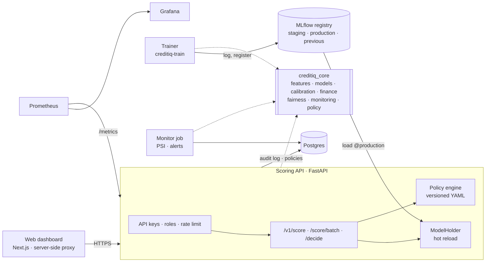

# CreditIQ

**A credit-decisioning platform: calibrated probability-of-default models, served by an API, governed by a
versioned lending policy, audited without storing applicant data, and monitored for drift — with a modern
dashboard on top.**

> **Educational decision-support prototype, not for real credit decisions.** Outcomes are *within threshold* or
> *flagged for review*, never approval or denial. The bundled data is synthetic.

**Live demo:** *not deployed yet* — see [docs/DEPLOY.md](docs/DEPLOY.md) (Render + Neon + Vercel, free tiers).

| Dark | Light |
|---|---|
|  |  |
|  |  |

---

## Architecture



| Component | What it does |
|---|---|
| [`packages/creditiq_core`](packages/creditiq_core) | Pure Python library (no I/O, no web framework): data validation and explicit target mapping, leakage guard, features, three model families, calibration, evaluation, explanations, expected loss and lending economics, portfolio analytics, fairness, drift, and the lending-policy engine. Strictly typed. |
| [`services/trainer`](services/trainer) | `creditiq-train`: YAML configs → MLflow runs (metrics, plots, model card) → registered versions with `staging` / `production` / `previous` aliases; promote, roll back, export. |
| [`services/api`](services/api) | FastAPI: scoring, batch scoring (streamed), decisions, models, portfolio, scenarios, policies, fairness, monitoring, audit log; API keys, rate limits, Prometheus metrics, JSON logs, Alembic migrations. |
| [`services/monitor`](services/monitor) | Scheduled drift job: PSI per input, PD drift, missingness, schema checks, labelled performance; live PD drift from the audit log; alerts to Postgres, Prometheus and an optional webhook. |
| [`web`](web) | Next.js (App Router, TypeScript), Tailwind, Radix, TanStack Query and Table, Recharts, Zod; API types generated from OpenAPI. |
| [`infra`](infra) | Docker Compose stack, Prometheus rules, provisioned Grafana dashboard, demo deployment image. |
| [`policies`](policies) | Versioned lending policies (YAML). |
| [`legacy`](legacy) | The v1 Streamlit prototype, unchanged and still runnable. |

Design decisions are recorded as [ADRs](docs/adr/README.md).

## Quick start

**Everything (Docker):**

```bash
docker compose up --build
```

The first start builds the images, trains the synthetic model, registers it in MLflow, promotes it to production
and seeds demo traffic (allow 5–10 minutes the first time). Then:

| URL | What |
|---|---|
| <http://localhost:3000> | dashboard (dev keys: analyst by default; switch to admin in the top bar) |
| <http://localhost:8000/docs> | API docs (`X-API-Key: dev-analyst-key-change-me`) |
| <http://localhost:5000> | MLflow |
| <http://localhost:3001> | Grafana (*CreditIQ — API, decisions and drift*) |
| <http://localhost:9090> | Prometheus |

Defaults are development-only; set your own in `.env` (see [`.env.example`](.env.example)).

**Without Docker (uv + pnpm):**

```bash
uv sync
uv run creditiq-train train --config services/trainer/configs/synthetic.yaml --no-mlflow \
    --file-registry models/registry --alias production
API_KEYS="analyst:dev-analyst-key-change-me,admin:dev-admin-key-change-me" uv run creditiq-api   # :8000

cd web && pnpm install && cp .env.example .env.local && pnpm dev                              # :3000
uv run python scripts/seed_demo.py --key dev-admin-key-change-me                               # optional demo traffic
```

## What you can do

- **Score an applicant** with a form generated from the model's schema (most influential inputs first): PD gauge,
  risk band, expected loss, a waterfall of the reasons, uncertainty (held-out reliability of the band), caveats,
  and a *what-if* mode that re-scores live as you drag inputs.
- **Simulate a lending policy**: edit thresholds, rules and the cost matrix in a form or as YAML, compare flag
  rate, expected loss, contribution and the confusion matrix with the active policy (validation split by default),
  and save it as a new version (admin).
- **Promote or roll back a model** with no downtime; see ROC/PR, calibration and a validation-only threshold
  explorer for each version.
- **Portfolio and scenarios**: exposure and EL by band, observed vs predicted by decile, HHI concentration,
  loss-concentration curve, lending economics, break-even PD and rate, PD × rate heatmap, stress tests, loan NPV.
- **Fairness**: group metrics, disparities and a proxy scan for attributes that are never model inputs.
- **Monitoring**: drift per input and for PDs, alert history, Grafana.
- **Audit**: every decision with its model and policy versions, rules fired and reasons — and an HMAC of the
  inputs, never the inputs.

## Guarantees carried over from v1

- Train / validation / test separation; calibration, threshold and model selection on validation only.
- Leakage guard on training rows only; explicit target mapping (1 is never assumed to mean default).
- Sensitive attributes are never model inputs and never usable by policy rules; they feed only the fairness audit.
- Every number has a provenance label: observed, measured, model, assumption, simulated, synthetic (enforced by a
  contract test over real API responses).
- Wording: *within threshold* or *flagged for review*.

## Results

### Synthetic data (bundled)

`services/trainer/configs/synthetic.yaml`, seed 42, stratified 60/20/20, Platt calibration, max-F1 threshold:

| Model | Validation ROC-AUC | Test ROC-AUC | Test PR-AUC | Test Brier | Test KS |
|---|---|---|---|---|---|
| Logistic Regression (selected on validation) | 0.798 | 0.813 | 0.290 | 0.0622 | 0.481 |
| Random Forest | 0.792 | 0.815 | 0.296 | 0.0623 | 0.491 |
| Gradient Boosting (LightGBM) | 0.785 | 0.807 | 0.290 | 0.0625 | 0.493 |

**Fabricated data; these numbers say nothing about real borrowers.** Test default rate 7.7% (PR-AUC's random
baseline). The same seed reproduces v1's published figures exactly (`scripts/check_v1_equivalence.py`).

### Real data: Home Credit Default Risk

`services/trainer/configs/home_credit.yaml` on Kaggle's `application_train.csv` (307,511 applications, 122
columns): 150,000 rows streamed at random (seed 42), 60,000 labelled rows trained, stratified 60/20/20, 115
predictors (identifiers excluded; `CODE_GENDER`, `DAYS_BIRTH`, `NAME_FAMILY_STATUS` kept out of the model for the
fairness audit), Platt calibration and max-F1 threshold on validation:

| Model | Validation ROC-AUC | Test ROC-AUC | Test PR-AUC | Test Brier | Test KS | Threshold |
|---|---|---|---|---|---|---|
| Gradient Boosting (LightGBM) (selected on validation) | 0.751 | **0.748** | 0.226 | 0.0688 | 0.378 | 12.3% |
| Logistic Regression | 0.749 | 0.739 | 0.210 | 0.0694 | 0.366 | 11.9% |
| Random Forest | 0.740 | 0.729 | 0.202 | 0.0698 | 0.355 | 14.3% |

Test default rate 8.1% (PR-AUC's random baseline). This model is registered as **v3** and serves as production
locally. Home Credit's `TARGET` is a payment difficulty on an early instalment, not a 12-month default. Only the
main application table is used (the bureau and previous-application tables can be added with
`creditiq-train build-features home-credit`). Real data is git-ignored and never committed.

Drift monitoring on real rows: a random sample of the same population gives max PSI 0.005 (no alert); a batch with
a deliberate shift (45% of `EXT_SOURCE_3` missing, incomes −20%, more cash loans) raises *feature shift* and
*missingness jump* alerts.

### Performance

k6 on a laptop (i3-1215U, 7.7 GB RAM, busy with other apps), one API worker, SQLite audit log — details and
caveats in [`loadtest/RESULTS.md`](loadtest/RESULTS.md):

| Endpoint | Load | RPS | p50 | p95 | p99 |
|---|---|---|---|---|---|
| `/v1/score` | 20 req/s for 60 s | 20.1 | 27.0 ms | **46.2 ms** | 176.0 ms |
| `/v1/decide` | 20 req/s for 60 s | 20.1 | 25.2 ms | 54.9 ms | 265.6 ms |
| `/v1/score` | 8 VUs back-to-back | 27.7 | 279.2 ms | 391.7 ms | 532.5 ms |

Target p95 < 50 ms for single-applicant scoring: **met for the 21-input synthetic model**. The 115-input Home Credit LightGBM model is slower on the same laptop (`/v1/score` p50 57 ms, p95 73 ms, sequential requests), and does not meet the target yet. Capacity of one worker is about 28 req/s; beyond that,
requests queue.

## Testing and CI

| Suite | Count | Where |
|---|---|---|
| Core library (incl. 98 tests ported from v1) | 125 | `packages/creditiq_core/tests` |
| Trainer (configs, reproducibility, package contents, MLflow flow) | 16 | `services/trainer/tests` |
| API (behaviour, privacy, hot reload, migrations, Postgres, contract) | 31 | `services/api/tests` |
| of which: Schemathesis contract checks over the OpenAPI document | 36 operations | `services/api/tests/test_contract.py` |
| Monitor | 5 | `services/monitor/tests` |
| Web end-to-end (Playwright: score, simulate, promote, drift, what-if, 375 px) | 19 | `web/e2e` |
| Legacy v1 app | 124 | `legacy/tests` |

GitHub Actions ([`ci.yml`](.github/workflows/ci.yml)): ruff, strict mypy, all Python tests on 3.11 and 3.12 with a
Postgres service, OpenAPI snapshot check, legacy tests, web typecheck/lint/build with a generated-types drift check,
Playwright against a live API and web, and Docker images to GHCR. A scheduled workflow runs a daily drift check on
the deployed demo and a weekly candidate retrain.

## Tech stack

Python 3.11+ · uv · scikit-learn · LightGBM · SHAP · pandas · Pydantic v2 · MLflow · FastAPI · SQLAlchemy 2 ·
Alembic · Postgres · Prometheus · Grafana · k6 · Next.js 16 · React 19 · TypeScript · Tailwind CSS 4 · Radix ·
TanStack Query/Table · Recharts · Zod · openapi-typescript · Playwright · Docker · GitHub Actions · Render · Neon ·
Vercel.

## Documentation

| Document | Contents |
|---|---|
| [docs/v2/MIGRATION_PLAN.md](docs/v2/MIGRATION_PLAN.md) | how v1 became v2, module by module |
| [docs/adr/](docs/adr/README.md) | 15 architecture decision records |
| [docs/RUNBOOK.md](docs/RUNBOOK.md) | retrain, promote, roll back, respond to drift, rotate keys |
| [docs/DEPLOY.md](docs/DEPLOY.md) | step-by-step public deployment |
| [docs/v2/DESIGN.md](docs/v2/DESIGN.md) | design system: tokens, type, components, chart rules, screenshots |
| [docs/MODEL_CARD.md](docs/MODEL_CARD.md) | model card (each registered version also gets its own) |
| [docs/METHODOLOGY.md](docs/METHODOLOGY.md) | statistics and finance formulas |
| [docs/DATA_SOURCES.md](docs/DATA_SOURCES.md) | synthetic, Home Credit, German Credit, LendingClub |
| [docs/api/openapi.json](docs/api/openapi.json) | the API contract |
| [loadtest/RESULTS.md](loadtest/RESULTS.md) | load-test method and results |

## Limitations

- Real-data results use one table of one public dataset with a random split; they are not evidence that the model would work for another lender, product or period.
- The PD is the probability of the dataset's own event; treating it as a 12-month PD is an assumption. LGD, EAD,
  rates and costs are assumptions. This is not an IFRS 9 or regulatory capital model.
- Explanations show association, not causation; fairness checks cover only the attributes available and are not
  legal advice.
- Random splits do not test performance on future cohorts.
- The hosted demo runs on free tiers: it sleeps when idle, and MLflow, Prometheus and Grafana run only locally.
- Rate limits are per process (no Redis); scale-out would need a shared limiter.

## Legacy v1

The original Streamlit app lives in [`legacy/`](legacy/README.md), unchanged and still runnable
(`cd legacy && pip install -r requirements.txt && streamlit run app.py`); its 124 tests run in CI.
