# CreditIQ design system

The v2 dashboard is a calm, dense, precise product UI: closer to Linear, Vercel or Stripe's dashboard than to a
bank. Nothing from v1's visual identity carries over (no navy sidebar, no serif headings, no paper-grey ledger
look). Dark is the primary theme; light is a complete, separately tuned theme.

| Dark | Light |
|---|---|
| 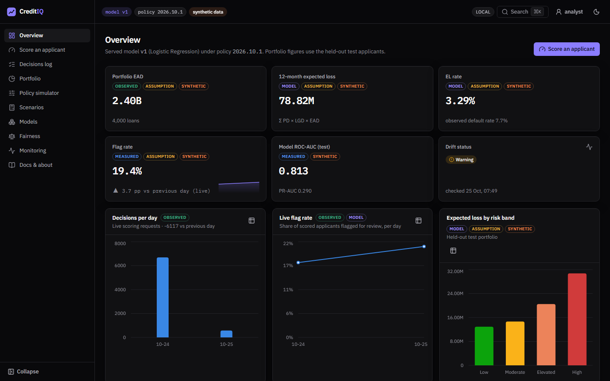 | 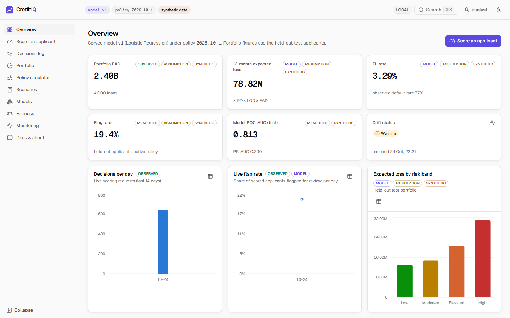 |
| 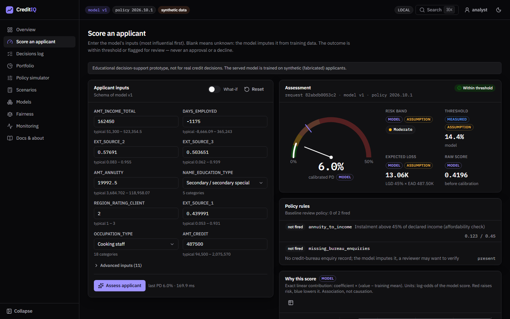 | 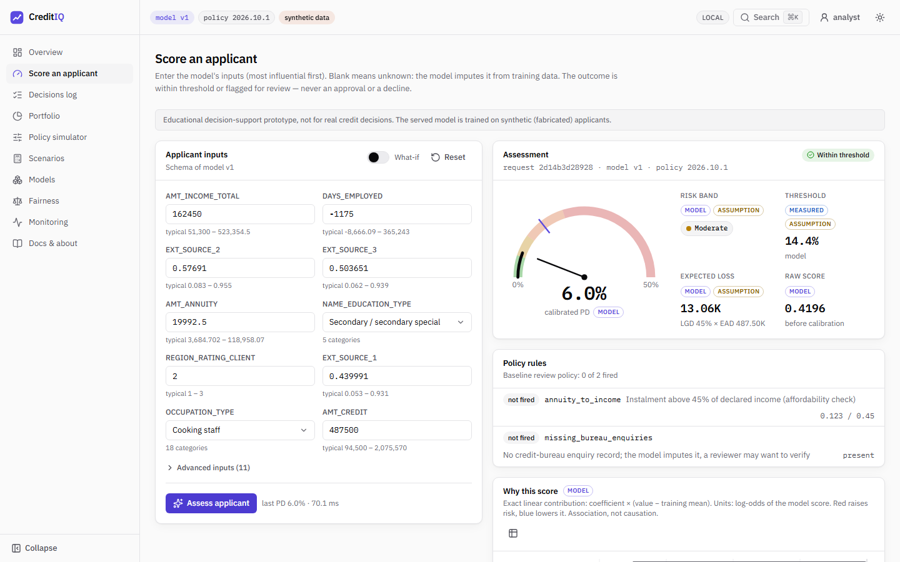 |
| 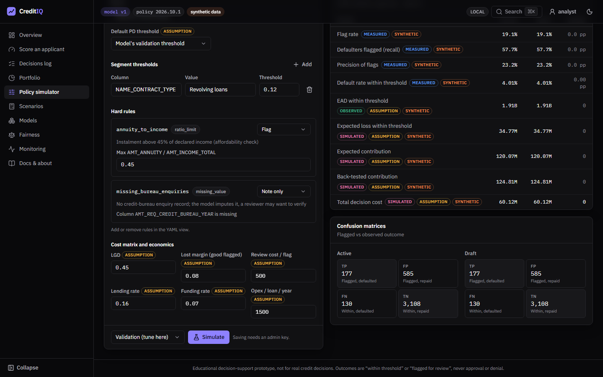 | 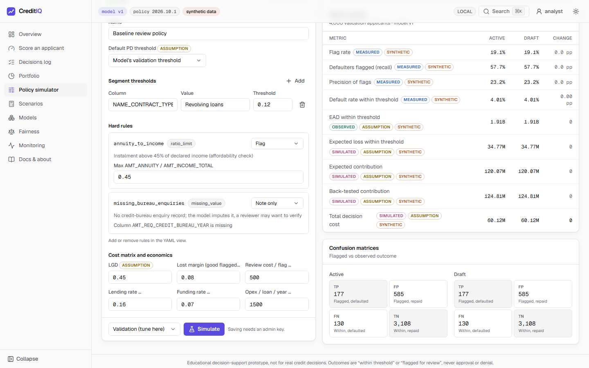 |
| 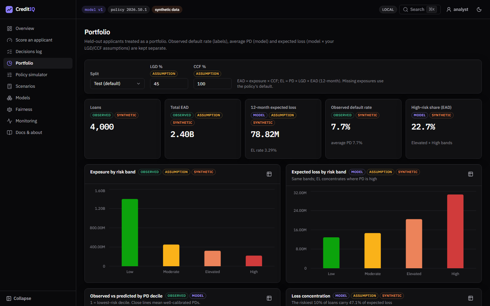 | 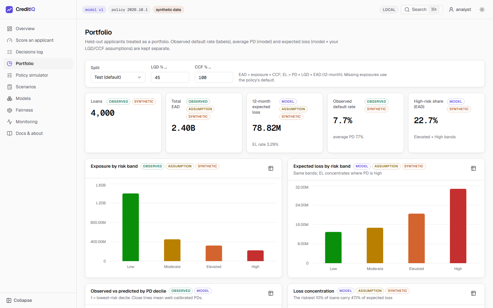 |
| 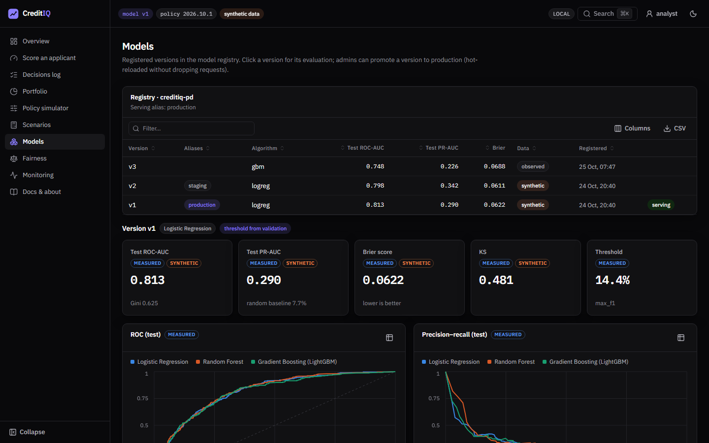 | 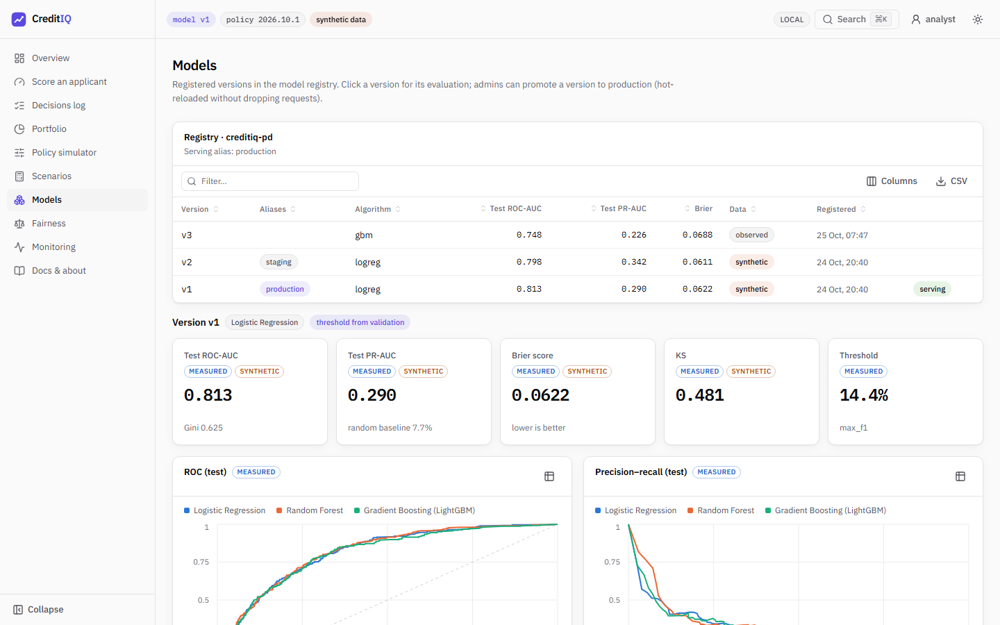 |
| 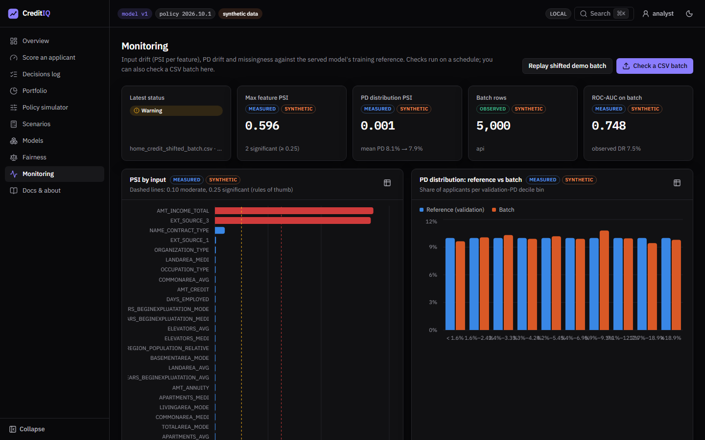 | 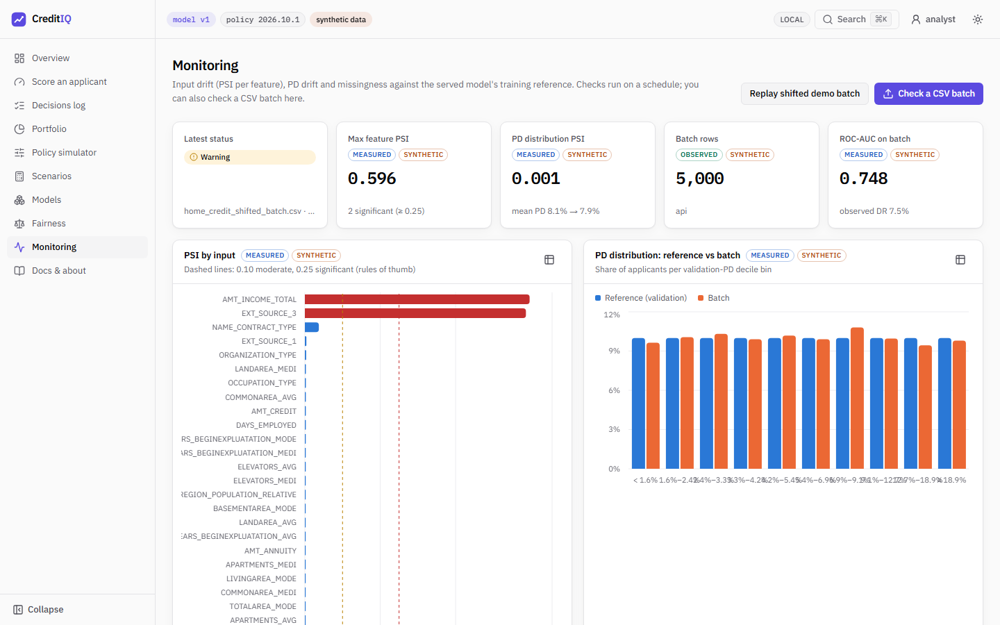 |

Screenshots are produced by `pnpm exec playwright test --project screenshots` against the running stack.

## Tokens

All colours are CSS custom properties in [`web/src/app/globals.css`](../../web/src/app/globals.css), defined once
per theme and mapped into Tailwind with `@theme inline` (`bg-surface`, `text-fg-muted`, `border-border`, …).
Components never contain hex values. The theme is `system` by default, can be switched in the top bar or the
command palette, and is remembered (`localStorage`, key `ciq-theme`).

| Role | Dark | Light | Use |
|---|---|---|---|
| `--bg` | `#09090b` | `#fafafa` | page |
| `--surface` / `-2` / `-3` | `#111113` / `#18181b` / `#1f1f23` | `#ffffff` / `#f4f4f5` / `#ececef` | cards, hovers, wells |
| `--border` / `-strong` | `#26262b` / `#3a3a41` | `#e4e4e7` / `#d0d0d6` | hairlines |
| `--fg` / `-secondary` / `-muted` | `#fafafa` / `#b4b4bd` / `#8e8e98` | `#09090b` / `#4f4f58` / `#6a6a73` | text (all ≥ 4.5:1 on surfaces) |
| `--accent` | `#8b7dff` | `#5b4ae0` | primary actions, focus ring, active nav |
| `--good` `--warning` `--serious` `--critical` | status steps | status steps | status, risk bands; always with an icon or label |
| `--prov-*` | 6 hues | 6 hues | provenance pills (always with a text label) |
| `--series-1..3` | `#3987e5` `#d95926` `#199e70` | `#2a78d6` `#eb6834` `#1baf7a` | chart series |

### Why electric indigo, not emerald

Risk bands need a green → red scale, and "green" already means *low risk* on this product. An emerald accent would
make every primary button and active link look like a risk signal. Indigo-violet is neutral with respect to risk,
reads as "product" rather than "bank", and keeps strong contrast in both themes (dark `#8b7dff` on `#111113` is
about 6:1; light `#5b4ae0` on white about 6:1).

## Typography

- **Geist Sans** for the UI and **Geist Mono** for numbers, IDs, versions and code (`geist` package; no serif
  fonts anywhere).
- Tabular figures for every number: `font-variant-numeric: tabular-nums` on tables, inputs and chart text, plus the
  `.num` utility.
- Scale (px): 11 (labels, pills) · 12 (secondary) · 13 (body, tables) · 14 (base) · 16 · 20 (page titles) · 24 (KPI
  values). Weights 400 / 500 / 600.

## Spacing, radius, motion

- 4-px grid; cards use 16 px padding; page gutter 16 px on phones and 24 px from `sm`.
- Radius 4 / 6 / 10 px (controls / inputs / cards).
- Transitions are 150–200 ms (colour, width of the collapsible nav) and are switched off under
  `prefers-reduced-motion`.

## Layout

- **Collapsible left nav** with Lucide icons (state remembered); on phones it becomes a drawer.
- **Top bar:** model-version and policy-version pills (links), a *synthetic data* pill when relevant, the
  environment badge, ⌘K command palette, role switch (analyst/admin; only when the server has an admin key) and the
  theme toggle.
- **Footer:** the disclaimer on every page: *Educational decision-support prototype, not for real credit decisions.*
- Dense data tables inside generous page whitespace; max content width 1400 px.

## Components

| Component | Behaviour |
|---|---|
| KPI card | label, provenance pills, value (mono, tabular), sub-line or change vs previous period (▲/▼ + colour + text), optional sparkline |
| Data table | sorting (keyboard-accessible header buttons, `aria-sort`), text filter, column visibility, CSV export of the filtered rows, pagination, skeleton rows while loading, explanatory empty state |
| Provenance pill | observed · measured · model · assumption · simulated · synthetic, each with a tooltip explaining the label |
| Band badge | dot in the band colour + the band name |
| Outcome badge | *Within threshold* (check icon) or *Flagged for review* (triangle icon); never approve/deny |
| Skeletons | shimmer blocks shaped like the content; no spinners |
| Empty states | say what is missing and what to do next |
| Toasts | `sonner`, bottom right, for results of actions |
| Command palette | `cmdk`: pages, theme, role |

## Chart rules

- One y-axis per chart; two measures with different scales get two charts (e.g. *Exposure by band* and *Expected
  loss by band*).
- Categorical series use the validated palette slots 1–3 in fixed order (validated with the dataviz
  `validate_palette.js`: all pairs pass CVD separation and the normal-vision floor in both themes; the light aqua
  is below 3:1 against white, so every chart ships a legend and a table view).
- Risk bands always use the same four band colours, everywhere.
- Diverging data (contributions, PD × rate margin) use blue ↔ red with a neutral grey midpoint; red raises risk or
  loses money.
- 2-px lines, 4-px rounded bar ends, recessive grid, tooltips on hover, no 3D, no rainbow scales.
- Every chart card has a table toggle with the same data (accessibility and CVD relief).

## Accessibility

- Keyboard: skip link, focus-visible rings, Radix primitives (dialogs trap focus, menus are arrow-key navigable),
  sortable headers and clickable rows reachable with Tab and Enter.
- Contrast: text tokens are at least 4.5:1 on their surfaces in both themes; status colours never carry meaning alone.
- Responsive down to 375 px wide; Playwright checks that six key pages have no horizontal overflow at 375 px.
