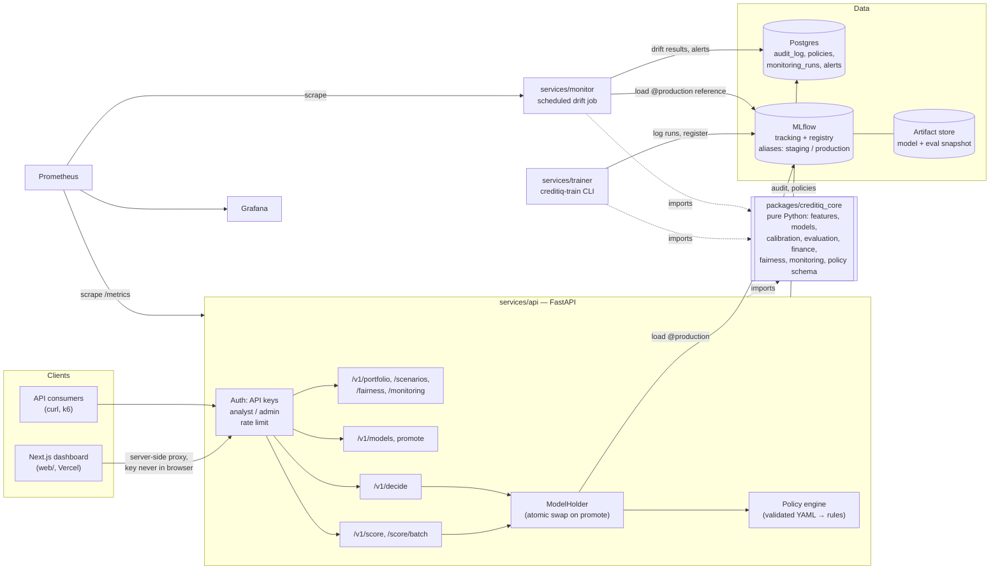

# CreditIQ v2 — Migration plan

Status: **Approved 2026-10-24.** Phase 1 in progress.

This plan maps every part of the v1 Streamlit prototype to its place in the v2 platform (scoring service → policy
engine → audit store → web dashboard). It lists what is reused, refactored and dropped, and records where the plan
deviates from the original brief and why. §0 records the decisions taken at approval; they take precedence over
anything later in the document that conflicts with them.

---

## 0. Decisions at approval (2026-10-24)

| # | Question (§9) | Decision |
|---|---|---|
| — | Repository | v2 lives in a **new folder**, `creditiq-v2/` (a sibling of the v1 folder), with its own git repo. No remote yet. The v1 app is copied **unchanged** into `legacy/` from day one (instead of in Phase 6), so it stays runnable and its 124 tests keep passing on their own. The v1 originals are not touched. |
| 1 | Home Credit data | **Optional.** Everything runs on the synthetic sample. The trainer ships a Home Credit config and the README explains the free Kaggle download; real metrics are added only if someone downloads the data. |
| 2 | Git | `git init` done; the GitHub repo will be created later. CI badges are added in Phase 6. |
| 3 | Evaluation snapshot | **Accepted** (§5.2). It follows the standard practice of keeping a scored hold-out set next to the model version. |
| 4 | Policy simulation split | Validation by default; test is a read-only check (§5.3). |
| 5 | Public demo admin actions | Disabled on the public deployment (`ALLOW_ADMIN_ACTIONS=false`). They work locally. |
| 6 | EAD in the audit log | Kept: it makes expected loss auditable, and v1 stored it too. |
| 7 | Audit write failure | **Simplified:** the audit row is written **synchronously** in the request's transaction. If Postgres is down, scoring returns 503; there are no unaudited decisions and no buffer to manage. This replaces the async queue in §5.4 and ADR 14. The latency cost (~1–3 ms locally) is measured in Phase 5. |
| 8 | Models to register | All three algorithms are trained and logged in one MLflow run. **Only the validation-selected model is registered**, as `creditiq-pd`. The Models page compares all three from that run's metrics. |
| 9 | Load-test hardware | Intel Core i3-1215U (6 cores / 8 threads), 7.7 GB RAM, Windows 11. Containers get modest memory limits so the full stack fits. |

---

## 1. What v1 is today (findings from the code)

| Area | Finding | Consequence for v2 |
|---|---|---|
| Size | ~4,500 lines in `src/`, ~2,300 in `app_pages/`, ~1,300 in `tests/`. | Small enough to move module by module without a rewrite. |
| Streamlit coupling | Only `src/ui.py` and `src/state.py` import Streamlit. The 12 core modules named in the brief are already Streamlit-free. | The core extraction is a **move plus refactor**, not an untangling job. |
| I/O in the "core" | `config.py` reads `.env` and creates folders at import time. `data_loader.read_csv_file` opens paths. `persistence.py` is SQLite plus joblib. | These are the only parts that break the "no I/O in core" rule. They are split out (§4). |
| Model object | `CreditModel` = sklearn `Pipeline` (clean → domain features → ColumnTransformer → estimator) + `ProbabilityCalibrator`. `ModelBundle` adds schema, threshold, metadata, monitoring reference and the training-mean vector for linear explanations. | This is almost exactly the artifact §3.2 asks for. It becomes the MLflow pyfunc payload, with one change (below). |
| Bundle contents | `ModelBundle.eval_val` / `eval_test` hold validation and test **labels and PDs** (no features). | Not training data, but they are row-level outcomes. In v2 they move out of the model artifact into a separate evaluation snapshot (§5.2). |
| Experiment object | `ExperimentResult` keeps the full sampled **frame** in memory. | Fine in the trainer process. It never goes into an artifact. |
| Audit hash | `hash_inputs` = unsalted SHA-256 truncated to 16 hex characters. | Applicant inputs are low-entropy, so an unsalted hash can be brute-forced. v2 uses **HMAC-SHA256 with a server-side secret** (§5.5). |
| Boosting backend | Auto-detects LightGBM → XGBoost → sklearn at runtime. | The same config can produce different models on different machines. v2 pins the backend in the training config and fails loudly if it is missing. |
| Explanations | Exact for logreg/LightGBM. RF needs `shap`, otherwise it falls back to occlusion (one extra prediction per feature). | Occlusion on ~25 features would put the 50 ms p95 target at risk. v2 makes `shap` a hard dependency of the API image and sets an explanation-latency budget. |
| Tests | 110 test functions, 124 cases after parametrization. 10 are Streamlit `AppTest` UI tests. 5 (`test_money_formatting_with_currency`) import Streamlit only to set session state. | 114 cases port to the core. The 10 AppTests stay with the Streamlit app until it moves to `legacy/` (§6). |
| Repo | Not a git repository yet. The project sits in a nested `Downloads/CreditIQ/CreditIQ/` folder. | Superseded by §0: v2 is a new sibling folder, `creditiq-v2/`, with its own git repo. |
| Real data | `data/raw/` is empty. The Home Credit files have not been downloaded. | Download instructions are in §9, Q1. Phase 2 needs them. |

Baseline test run: see §10 (recorded before any change).

---

## 2. Target architecture



### Repository layout (target)

```
creditiq-v2/                      # repo root (new folder, see §0)
├── pyproject.toml  uv.lock       # uv workspace root; ruff/mypy/pytest config
├── packages/creditiq_core/       # installable library, src layout, py.typed
│   ├── src/creditiq_core/
│   │   ├── data/                 # validation, target mapping, roles, leakage, csv parsing (file-like in), synthetic generator
│   │   ├── features/             # FrameCleaner, DomainFeatureBuilder, preprocessing, splits
│   │   ├── models/               # estimators, CreditModel, training run, artifact dataclass
│   │   ├── calibration.py  evaluation.py  explainability.py
│   │   ├── finance/              # financial_calculations, portfolio_analysis, decision_engine (cost matrix)
│   │   ├── policy/               # NEW: policy schema (Pydantic), rule evaluation, simulation
│   │   ├── fairness.py  monitoring.py
│   │   ├── reporting/            # model card markdown, provenance enum
│   │   ├── formatting.py         # money/pct formatting (pure; currency is an argument)
│   │   └── defaults.py           # LGD, CCF, band cutoffs, PSI thresholds, disclaimer (constants, no env)
│   └── tests/                    # 114 ported v1 tests + new ones
├── services/
│   ├── api/       (app/, alembic/, tests/, Dockerfile)
│   ├── trainer/   (creditiq_trainer/, configs/*.yaml, tests/, Dockerfile)
│   └── monitor/   (creditiq_monitor/, tests/, Dockerfile, crontab)
├── web/                          # Next.js App Router, pnpm
├── policies/                     # v1.yaml, … (reviewed source of truth, seeded into Postgres)
├── infra/  docker-compose.yml  prometheus/  grafana/  deploy/
├── loadtest/                     # k6 scripts + RESULTS.md
├── scripts/                      # replay_monitoring_batch.py, seed_demo.py, generate_sample_data.py
├── data/                         # unchanged: synthetic sample + shifted batch; raw/ git-ignored
├── docs/  v2/  adr/              # METHODOLOGY (updated), MODEL_CARD, RUNBOOK, DESIGN, API
├── legacy/                       # Phase 6: Streamlit app + its 10 AppTests
└── .github/workflows/
```

---

## 3. Module-by-module mapping

Legend: **Reuse** = moved with import-path changes only. **Refactor** = moved with a defined change. **Drop** =
not carried into v2 (kept in `legacy/` where noted).

### 3.1 `src/` → v2

| v1 module | v2 location | Action | What changes |
|---|---|---|---|
| `financial_calculations.py` | `creditiq_core/finance/economics.py` | **Reuse** | Type hints on public functions only. `DEFAULT_SCENARIOS` stays. |
| `evaluation.py` | `creditiq_core/evaluation.py` | **Reuse** | Type hints. `METRIC_HELP` stays (the UI reads it via the API). |
| `calibration.py` | `creditiq_core/calibration.py` | **Reuse** | Type hints. |
| `decision_engine.py` | `creditiq_core/finance/cost_matrix.py` | **Reuse** | Becomes the cost-matrix layer *under* the new policy engine (§5.3). `compare_policies` is kept as the v1 four-policy benchmark. |
| `fairness.py` | `creditiq_core/fairness.py` | **Reuse** | Type hints. |
| `monitoring.py` | `creditiq_core/monitoring.py` | **Refactor (small)** | `drift_alerts` currently reads PSI thresholds from `config`. They become parameters, defaulting to `defaults.PSI_*`, so the monitor service can configure them. Adds a structured alert type (`code`, `severity`, `message`, `value`, `threshold`) next to the existing strings. |
| `portfolio_analysis.py` | `creditiq_core/finance/portfolio.py` | **Reuse** | `config` → `defaults`. |
| `explainability.py` | `creditiq_core/explainability.py` | **Refactor (small)** | Moved unchanged in Phase 1. A single-row fast path for `top_reasons` (precomputed origin-index map, no per-call `groupby`) is added in Phase 3/5 **only if** the latency measurement shows it is needed, with a test that it matches the existing function. `shap` becomes required in the API image. |
| `preprocessing.py` | `creditiq_core/features/preprocessing.py` | **Reuse** | — |
| `feature_engineering.py` | `creditiq_core/features/engineering.py` | **Reuse** | — |
| `modeling.py` | `creditiq_core/models/` (`estimators.py`, `credit_model.py`, `training.py`, `artifact.py`) | **Refactor** | (1) The boosting backend is an explicit config value; a missing library raises an error instead of falling back silently. (2) `ModelBundle` → `ModelArtifact`: pipeline, calibrator, input schema, threshold and its rule, monitoring reference, transformed mean, metadata, `format_version=2`. **No eval arrays** (they go to the evaluation snapshot). (3) `ExperimentResult.bundle()` → `to_artifact()` + `evaluation_snapshot()`. (4) `experiment_id` uuid → MLflow run id, supplied by the caller. The training algorithm itself is unchanged. |
| `data_validation.py` | `creditiq_core/data/validation.py` | **Reuse** | `quality_report` stays (the trainer logs it to MLflow). |
| `data_loader.py` | split: `creditiq_core/data/{csv.py,synthetic.py}` + trainer | **Refactor** | Sniffing and parsing take **bytes or file-like** objects (pure). Opening paths, `list_local_csv_files` and the row-count helper move to the trainer. The synthetic generator stays in the core (deterministic given a seed). `sanitize_filename` stays in the core (a pure string function used by the dataset record). |
| `config.py` | split: `creditiq_core/defaults.py` + per-service `settings.py` | **Refactor** | Domain constants → core. Paths, env vars and `.env` → `pydantic-settings` in each service. No import-time side effects. |
| `reporting.py` | `creditiq_core/reporting/` | **Refactor (partial)** | `model_card_markdown` and the provenance vocabulary are kept, and the trainer logs the model card to MLflow. The HTML/Markdown "project report" is **dropped** in v2: the dashboard and the MLflow run replace it. It stays available in `legacy/`. |
| `persistence.py` | replaced | **Drop + replace** | SQLite → Postgres (SQLAlchemy 2 + Alembic) in the API. joblib bundles → MLflow artifacts. `hash_inputs` → HMAC (§5.5). `to_json`/`_sanitize` (NaN-safe JSON) moves to the core as a utility, because the API needs it too. |
| `state.py` | — | **Drop** (`legacy/`) | Streamlit session state. Its *invalidation rules* (new model → stale policy/fairness results) become cache keys in v2: every analytics response is keyed by `(model_version, policy_version, assumptions hash)`. |
| `ui.py` | — | **Drop** (`legacy/`) | Streamlit design system and v1 palette. Formatting helpers (`money`, `pct`, `num`, `dec`, `val`) → `creditiq_core/formatting.py` with currency as an argument; the TypeScript side gets its own formatter with the same rules. |
| `__init__.py` | `creditiq_core/__init__.py` | Refactor | Version `2.0.0.dev0`; public API re-exports. |

### 3.2 Everything else

| v1 item | v2 | Action |
|---|---|---|
| `app.py`, `app_pages/*`, `.streamlit/`, `static/fonts/*`, `run_app.*` | `legacy/` in Phase 6 | Stay runnable until then (the imports switch to `creditiq_core` in Phase 1). |
| `scripts/train_cli.py` | `services/trainer` → `creditiq-train` | **Refactor**: argparse flags → YAML config; adds MLflow logging and registration. |
| `scripts/build_home_credit_features.py` | `services/trainer/.../features/home_credit.py` → `creditiq-train build-features home-credit` | **Reuse** (it is pandas I/O, so it belongs in the trainer, not the core). |
| `scripts/convert_german_credit.py` | `services/trainer/.../datasets/german.py` | **Reuse**. |
| `scripts/generate_sample_data.py` | `scripts/` | **Reuse** (calls the core generator). |
| `data/*.csv` | unchanged | Synthetic sample, plus the shifted batch for the drift replay. |
| `requirements*.txt` | `pyproject.toml` per package + `uv.lock` | Replaced. Legacy keeps its own `requirements.txt`. |
| `assets/logo.svg`, `assets/icon.svg` | replaced in Phase 4 | New identity. |
| `docs/METHODOLOGY.md`, `DATA_SOURCES.md`, `TROUBLESHOOTING.md` | updated | Paths and v2 behaviour. |
| `docs/MODEL_CARD.md` | updated in Phase 7 | Static card. A per-version card is generated into MLflow. |
| `docs/QA_AUDIT.md` | kept as a v1 historical record | The defects it lists become named regression tests (already done). |
| `docs/PROJECT_REPORT_TEMPLATE.md`, `PRESENTATION_OUTLINE.md` | `docs/v1/` | Course material; not part of the product. |

---

## 4. How the v1 methodological guarantees are kept

| Guarantee | Where it lives in v2 | How it is enforced |
|---|---|---|
| Train / validation / test separation | `creditiq_core.models.training` (unchanged algorithm) | Ported test `test_threshold_and_calibration_never_see_test_rows`. The trainer logs split sizes and fingerprints. |
| Calibration and threshold on validation only | same | Ported tests. The artifact records `threshold_rule` and `threshold_source="validation"`. |
| Leakage guard on training rows only | same | Ported `test_leakage_guard_screens_training_rows_only`. Guard exclusions are logged as an MLflow param. |
| Explicit target mapping | Trainer YAML: `target.column`, `target.default_values` **required**, with no default | Config schema test: a missing `default_values` → validation error. |
| Sensitive attributes out of the model | YAML `sensitive_columns` (auto-suggested and merged); stored in the evaluation snapshot **only** | Artifact test: no sensitive column is in `input_schema`. The API's request model is built from `input_schema`, so it **cannot** accept them. |
| Provenance labels on every number | Core `Provenance` enum; every API response model carries a `provenance` map | A contract test walks every response schema and fails if any numeric field has no provenance entry (§5.6). |
| "Within threshold" / "flagged for review" | Response enums `within_threshold` / `flagged_for_review`; no approve/deny anywhere | A repo-wide test greps the API and web sources for `approve`/`deny`/`reject` in user-facing strings (allow-listed for the v1 "approve-all baseline" policy name). |

---

## 5. Design decisions, including where I deviate from the brief

These are my recommendations. Points marked **⚠ deviation** change what the brief asked for, and each is backed by an
ADR.

### 5.1 Model artifact and registry
- Each registered model version is an MLflow **pyfunc** wrapping `ModelArtifact`. `predict()` returns the PD, so
  generic MLflow tooling works. The API calls `unwrap_python_model()` to reach the full object (schema, explainer,
  reference).
- **Aliases, not stages.** MLflow stages are deprecated, so I use the `staging`, `production` and (after a promotion)
  `previous` aliases. Rollback = moving `production` back to the version `previous` points to.
- Each version is tagged with: dataset fingerprint, `is_synthetic`, git SHA, config hash, seed, core version.
- MLflow runs locally in Docker: Postgres backend (a separate `mlflow` database) and a file artifact volume. MinIO/S3
  is not needed.

### 5.2 Evaluation snapshot (new; needed for portfolio, fairness and policy simulation)
The portfolio, fairness and policy-simulator pages all need held-out rows: PD, label, EAD, segment fields, the
sensitive attribute for fairness, and the fields the policy hard rules read (annuity, income, bureau-enquiry count).
v1 got these from the in-memory session. v2 cannot, and §3.2 forbids putting training data in the model artifact.

**Proposal:** the trainer writes a separate, versioned **evaluation snapshot** (Parquet) as an MLflow run artifact
next to the model. It holds the validation and test splits only (never training rows), and only the columns listed
above. The API loads it once per model version. For the synthetic and Home Credit data (both public), this is
acceptable. For any private dataset it would need a governance decision, and the README will say so. → Q3.

### 5.3 Policy engine
- A policy is a Pydantic-validated YAML document: `version`, `parent_version`, `pd_threshold` (default plus
  per-segment overrides keyed on e.g. `NAME_CONTRACT_TYPE`), `band_cutoffs`, `hard_rules[]` (typed:
  `ratio_limit`, `missing_value`, `range`, `category_in`), and `cost_matrix` (re-uses `CostAssumptions`). Unknown keys
  are rejected. Errors are reported with the YAML path and line (`rules[2].limit: must be > 0`).
- **Model threshold vs policy threshold:** the model's validation-chosen threshold is a *recommendation* stored in the
  artifact. A policy uses it with `pd_threshold: {default: model}` or overrides it. Every decision records both values
  and which one was applied.
- **Storage ⚠ deviation:** `policies/*.yaml` in git are the reviewed source of truth and are **seeded** into a
  Postgres `policies` table at startup (immutable rows, content hash). The brief asks admins to "save as new policy
  version" from the UI. On a hosted demo the filesystem is ephemeral and the API cannot commit to git, so UI-saved
  versions are written to Postgres (`source=ui`) and can be exported as YAML for a PR. Activating a policy is an
  admin action, recorded in the audit log.
- **Simulation split ⚠ deviation:** v1 deliberately kept the threshold explorer on *validation* so that test outcomes
  never steer choices. A policy simulator that lets a user tune thresholds against the *test* set re-opens exactly
  that leak. I propose: tune on **validation** by default. The **test** view is a read-only "final check", shown with
  a `measured (test)` provenance badge and a warning that iterating on it invalidates it. → Q4.

### 5.4 Serving
- **Request schema:** the API builds a Pydantic model from the artifact's `input_schema` at load time
  (`create_model`, `extra="forbid"`, typed numeric fields with optional ranges, `Literal` categories, plus an "unknown
  category" escape hatch that matches v1's infrequent-bucket behaviour). Unknown fields → 422 that names the field;
  missing fields → 422 unless the schema marks them as nullable (v1 imputes missing values, so most are).
- **Generated TS client vs dynamic schema ⚠ clarification:** the OpenAPI *envelope* types are static and generated
  into `web/` with `openapi-typescript` (committed snapshot; CI fails on drift). The *applicant fields* change with
  the model, so the score form renders from `GET /v1/models/{version}/schema` at runtime, validated with Zod schemas
  built from that response. The live `/openapi.json` also embeds the active model's applicant schema, so docs and
  Schemathesis contract tests see real fields.
- **Hot reload:** a `ModelHolder` keeps an immutable `(artifact, policy, snapshot)` tuple. Promotion (or a 30 s
  registry poll, needed for multiple workers and replicas) loads the new version in the background, warms it with
  one prediction, then swaps the reference atomically. In-flight requests finish on the tuple they started with, and
  a test fires concurrent requests during a promotion and checks there are no errors.
- **Batch:** CSV or JSON input, with a row limit (default 10,000) and a body-size limit (default 5 MB). Output streams
  as NDJSON or CSV in chunks of 1,000 rows. Batch rows are audited as one batch record plus per-row hashes.
- **Rate limiting:** `slowapi`, in-process, per API key. Redis is not required. Limits are per worker, and the docs
  say so.
- **Metrics:** `prometheus_client` with multiprocess mode, because the image runs uvicorn with more than one worker.
- **Latency budget for p95 < 50 ms:** validation ~1 ms; pipeline `predict_proba` on one row ~3–8 ms (pandas overhead
  dominates); explanation ~2–10 ms (exact methods only); audit insert asynchronous via a bounded queue (target ≤ 1 ms
  on the request path). If the RF + `shap` path misses the budget, `top_reasons` for RF moves to a precomputed
  `TreeExplainer`, and the k6 results report latency per model type.

### 5.5 Audit log and privacy
- Table `decisions`: `request_id` (UUIDv7), `ts`, `endpoint`, `api_key_id` (never the key), `model_version`,
  `policy_version`, `pd`, `raw_score`, `band`, `outcome`, `rules_fired` (JSONB), `top_reasons` (feature names and
  signed contributions only, **no values**), `expected_loss`, `ead`, `input_hash`, `batch_id`.
- `input_hash = HMAC-SHA256(AUDIT_HASH_KEY, canonical_json(inputs))`. The key comes from env and is rotatable; a
  `hash_key_id` column records which key was used. This is stronger than the "salted hash" in the brief: a per-row
  salt would make the same applicant impossible to match across requests, which is the reason to hash at all.
- Request bodies are never logged. The structured logger has a redaction filter, and a test asserts that applicant
  values never appear in captured logs.
- `ead` is stored because v1's assessment log stored it. It is an applicant input (requested amount). → Q6: keep it
  or drop it?

### 5.6 Provenance in the API
Wrapping every number as `{value, provenance}` doubles payload size and makes clients awkward. Instead, every response
carries a sibling map: `"provenance": {"pd": "model", "expected_loss": ["model", "assumption"], "threshold":
"measured"}`. Combined values (e.g. EL = model PD × assumed LGD) list every source. Datasets carry a
top-level `data_provenance: "synthetic" | "observed"`. The contract test from §4 enforces coverage.

### 5.7 Auth for the web dashboard
API keys must not reach the browser. The Next.js app calls the API from **server-side route handlers**, which hold
the key. In local dev, a role switcher picks the analyst or admin key. On the **public demo**, admin actions
(promote, activate policy) would be open to anyone → Q5.

### 5.8 Deployment ⚠ deviation
- **Fly.io** has had no free tier for new accounts since 2024, so I recommend **Render** (free web service) for the
  API.
- Render's free Postgres expires after 30 days, so I recommend **Neon** (free, persistent) for the database.
- A hosted MLflow server would exceed every free tier's memory. On the demo, the API loads the model from an
  **exported registry version** (the same MLflow model directory, baked into the image by CI), and `/v1/models`
  reads registry metadata exported alongside it. The full MLflow registry, Prometheus and Grafana run in
  `docker compose` locally. The README states this split plainly.
- Render's free tier sleeps after 15 minutes idle, so the first request after a sleep takes about 30–60 s. The README
  says so, and the scheduled GitHub Action pings `/healthz` before the monitoring run.
- Web → **Vercel** (free).

### 5.9 Tooling
- `uv` workspace (one lockfile). Python **3.12** in the images, with CI testing 3.11 and 3.12. Your machine has 3.13,
  and the core is tested on it locally too.
- `ruff` (lint + format). `mypy --strict` on `creditiq_core` and the trainer with `pandas-stubs`, relaxing only `disallow_any_generics` and `warn_return_any` (untyped scikit-learn objects would otherwise need casts everywhere).
  sklearn has no stubs, so `ignore_missing_imports` applies to sklearn, lightgbm and shap only.
- `pnpm` via `corepack enable` (pnpm is not installed on this machine).
- OpenTelemetry: optional, Phase 5 stretch goal (FastAPI + SQLAlchemy auto-instrumentation, OTLP to a Jaeger
  container).

### 5.10 Accent colour (for DESIGN.md)
I recommend **electric indigo/violet** over emerald. Risk bands need a green → red scale, and an emerald accent would
read as "low risk" on every button and link. Indigo is neutral with respect to the risk semantics. Final tokens are in
Phase 4.

---

## 6. Test porting plan

| v1 test file | Cases | Destination | Notes |
|---|---|---|---|
| `test_financial_calculations.py` | 14 | core | import paths only |
| `test_metrics.py` | 10 | core | |
| `test_decision_engine.py` | 7 | core | |
| `test_data_validation.py` | 12 | core | |
| `test_target_mapping.py` | 8 | core | |
| `test_modeling.py` | 14 | core | the bundle tests become artifact tests; the "eval arrays in bundle" assertions move to the snapshot tests |
| `test_portfolio_fairness_monitoring.py` | 6 | core | |
| `test_audit_regressions.py` | 24 | core | the money-format test is rewritten against the pure `formatting.money(v, currency=…)` with the same 5 cases; Streamlit is no longer imported |
| `test_reporting_persistence.py` | 6 | core (model card, JSON) + api (audit) | the SQLite audit test → Postgres audit test in Phase 3; the HTML report tests go to legacy |
| `test_scripts.py` | 3 | trainer (2 in Phase 1; the CLI test in Phase 2) | Home Credit enrichment and German conversion on mock files; the CLI test → `creditiq-train` on the synthetic sample |
| `test_app_smoke.py`, `test_app_audit.py` | 10 | stay with the Streamlit app → `legacy/tests/` in Phase 6 | still run in CI until Phase 6; their *behaviours* are re-expressed as API and Playwright tests (validation-only threshold explorer, invalidation on model change, portfolio filters change numbers, horizon drives economics, privacy) |
| `conftest.py` | — | core `conftest.py` | env redirection is no longer needed once the core has no I/O |

**Phase 1 exit criterion (revised by decision §0):** because v1 is copied unchanged into `legacy/`, its full
**124-test suite keeps passing there**. Separately, the core and trainer suites pass with the ported tests plus new
ones (artifact round-trip, no sensitive columns in the schema, explicit backend, structured alerts). The SQLite,
HTML-report and Streamlit tests are not ported: v2 replaces that code (Postgres audit log in Phase 3, MLflow model
card in Phase 2, web UI in Phase 4) and re-tests the behaviour there.

---

## 7. Phase plan

| Phase | Deliverables | Exit criteria |
|---|---|---|
| **0 — Plan** | This document, the architecture diagram, the ADR list | Your approval |
| **1 — Core** | `git init`; uv workspace; `creditiq_core` package; ported tests; ruff + mypy; v1 frozen in `legacy/` | core + trainer green; legacy 124 green; mypy clean; `streamlit run app.py` still works from `legacy/` |
| **2 — Trainer** | `creditiq-train` (YAML configs for the synthetic sample and Home Credit raw/enriched); MLflow logging (params, per-split metrics, calibration/ROC/PR plots, model card, quality report); registration + aliases; evaluation snapshot; reproducibility test (same seed → identical metrics and predictions) | Synthetic results reproduce the v1 README table; Home Credit test metrics in the README (needs the data) |
| **3 — API** | All `/v1` endpoints; policy engine + `policies/v1.yaml`; Postgres + Alembic; auth + rate limit; audit log; JSON logging; Prometheus metrics; hot reload; pytest + httpx tests; Schemathesis contract tests | Every endpoint tested; contract tests green; no raw inputs stored or logged (asserted) |
| **4 — Web** | Tokens, shell, theme, core components → the ten pages in order; generated API client; Playwright for score / policy simulation / promote / drift | E2E green in both themes; axe accessibility check has no serious violations; 375 px layout verified |
| **5 — Observability + perf** | Grafana dashboards (provisioned); monitor service + cron; drift replay script; k6 scripts; `loadtest/RESULTS.md` | Drift alert fires on the replay; p95 < 50 ms single-score on your laptop (or an explanation of the gap) |
| **6 — CI/CD + deploy** | Workflows: lint, type check, core, API (Postgres service container), E2E, image build to GHCR, scheduled monitor; Render + Neon + Vercel configs; step-by-step account guide; Streamlit → `legacy/` | Green CI; live URLs |
| **7 — Docs** | README rewrite, ADRs, RUNBOOK, DESIGN with screenshots, MODEL_CARD v2, API docs | Definition-of-done checklist ticked |

---

## 8. ADRs to write (`docs/adr/`)

1. Separate lending policy from the model (versioned, validated policy documents).
2. MLflow tracking + registry with aliases (not stages); exported model for the hosted demo.
3. Calibration, threshold and model selection on validation only; policy simulation defaults to validation.
4. Audit log stores an HMAC of inputs, never the inputs; key rotation.
5. Next.js + FastAPI over Streamlit.
6. Evaluation snapshot as a separate artifact (what is stored, and why it is not training data).
7. Policies: git YAML as the source of truth, Postgres for runtime versions.
8. Runtime-generated request schemas vs a static OpenAPI envelope.
9. Hot reload by atomic reference swap + registry polling.
10. Provenance as a response-level map rather than wrapped values.
11. Pinned boosting backend (no silent fallback) for reproducibility.
12. Deployment targets: Render + Neon + Vercel, and what is deliberately not hosted.
13. uv workspace monorepo.
14. Synchronous scoring with an asynchronous audit write (durability trade-off and bounded-queue behaviour when
    Postgres is down: fail closed or open → Q7).

---

## 9. Open questions

1. **Home Credit data.** Download it before Phase 2: Kaggle → *Home Credit Default Risk* → accept the competition
   rules → download `application_train.csv` (~160 MB), plus `bureau.csv` and `previous_application.csv` if you want
   the enriched run. Put them in `data/raw/`. Should Phase 2 report both raw and enriched metrics, or raw only?
2. **Repo root and git.** OK to `git init` in `Downloads/CreditIQ/CreditIQ/` as the repo root? Do you have a GitHub
   repo name in mind for Phase 6 (the CI badge URLs depend on it)?
3. **Evaluation snapshot (§5.2).** Do you accept storing held-out rows (validation + test, limited columns) as a
   separate run artifact for portfolio, fairness and policy simulation? The alternative is to compute those
   analytics at training time only. That removes row storage but loses the interactive policy simulator and editable
   LGD/CCF.
4. **Policy simulation on validation by default, test as a read-only check (§5.3).** Agree?
5. **Public demo admin actions.** Options: (a) disable promote/activate on the public deployment; (b) a shared demo
   admin key that resets nightly; (c) admin requires a key you hold. I recommend (a) plus a recorded GIF of the
   promote flow.
6. **EAD in the audit log.** Keep it (v1 did, and it makes EL auditable) or drop it as an applicant input?
7. **Audit write failure.** If Postgres is unreachable, should scoring fail closed (503: no unaudited decisions,
   which is my recommendation for `/decide`) or fail open with a buffered retry (better for `/score`)? My proposal:
   closed for `/decide`, open with a bounded buffer for `/score`.
8. **Models to ship.** Keep all three algorithms in the trainer, with the registry holding the validation-selected
   one? Or register all three as separate model names so the Models page can compare them?
9. **Load-test target machine.** Your laptop's CPU and RAM, so `RESULTS.md` states the hardware.

---

## 10. Baseline before migration

Recorded on 2026-10-24 in a clean scratch venv (Python 3.12, Windows 11, `requirements.txt` +
`requirements-optional.txt`): **124 passed, 0 failed** (exit code 0). This is the first recorded Windows run; v1's
QA audit covered Linux only. With no environment installed, the system Python (3.13) has no Streamlit, so `pytest`
there fails at import for the 5 currency-format cases. This is expected and is fixed by §6.
